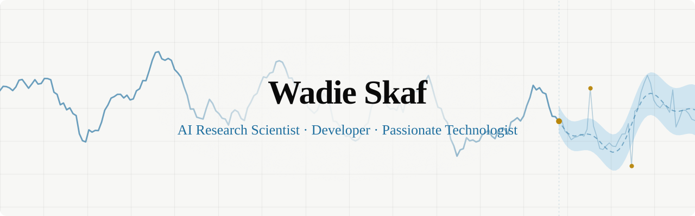

  <picture>
    <source media="(prefers-color-scheme: dark)" srcset="assets/badges/header-surface-dark-47376372.svg" />
    
  </picture>

I am an AI Research Scientist and PhD candidate in Computer Science at
RWTH Aachen University. I research uncertainty
quantification, conformal prediction, and self-supervised representation learning
for time series, building trustworthy, uncertainty-aware models that depend less
on labelled data and manual algorithm design.

---

## Research Focus

| Area | Topics |
| :--- | :--- |
| **Time series** | Self-supervised representation learning, classification, and forecasting |
| **AutoML** | Meta-learning, neural architecture search (NAS), and hyperparameter optimization (HPO) |
| **Uncertainty quantification** | Conformal prediction |

---

## Technical Skills

| Category | Skills |
| :--- | :--- |
| **Core** | <picture><source media="(prefers-color-scheme: dark)" srcset="assets/badges/badge-machine-learning-dark-730173df.svg" /></picture> <picture><source media="(prefers-color-scheme: dark)" srcset="assets/badges/badge-deep-learning-dark-35ab8e4f.svg" /></picture> <picture><source media="(prefers-color-scheme: dark)" srcset="assets/badges/badge-statistics-dark-b1a790c6.svg" /></picture> <picture><source media="(prefers-color-scheme: dark)" srcset="assets/badges/badge-mathematics-dark-c9346294.svg" /></picture> <picture><source media="(prefers-color-scheme: dark)" srcset="assets/badges/badge-scientific-computing-dark-55821e5e.svg" /></picture> <picture><source media="(prefers-color-scheme: dark)" srcset="assets/badges/badge-software-engineering-dark-5ade2520.svg" /></picture> <picture><source media="(prefers-color-scheme: dark)" srcset="assets/badges/badge-cloud-engineering-dark-e8a14dbe.svg" /></picture> |
| **Languages** | <picture><source media="(prefers-color-scheme: dark)" srcset="assets/badges/badge-python-dark-4f10969b.svg" /></picture> <picture><source media="(prefers-color-scheme: dark)" srcset="assets/badges/badge-c-dark-2a754485.svg" /></picture> <picture><source media="(prefers-color-scheme: dark)" srcset="assets/badges/badge-rust-dark-fadabd1c.svg" /></picture> <picture><source media="(prefers-color-scheme: dark)" srcset="assets/badges/badge-javascript-dark-dfe78f53.svg" /></picture> <picture><source media="(prefers-color-scheme: dark)" srcset="assets/badges/badge-typescript-dark-057d19a0.svg" /></picture> <picture><source media="(prefers-color-scheme: dark)" srcset="assets/badges/badge-sql-dark-3d370842.svg" /></picture> <picture><source media="(prefers-color-scheme: dark)" srcset="assets/badges/badge-bash-dark-a46b26e7.svg" /></picture> |
| **ML & DL** | <picture><source media="(prefers-color-scheme: dark)" srcset="assets/badges/badge-pytorch-dark-8a7a6df3.svg" /></picture> <picture><source media="(prefers-color-scheme: dark)" srcset="assets/badges/badge-lightning-dark-c842992a.svg" /></picture> <picture><source media="(prefers-color-scheme: dark)" srcset="assets/badges/badge-tensorflow-dark-4a4bf540.svg" /></picture> <picture><source media="(prefers-color-scheme: dark)" srcset="assets/badges/badge-keras-dark-186a0160.svg" /></picture> <picture><source media="(prefers-color-scheme: dark)" srcset="assets/badges/badge-scikit-learn-dark-4a36742a.svg" /></picture> |
| **Data** | <picture><source media="(prefers-color-scheme: dark)" srcset="assets/badges/badge-pandas-dark-dbb62ef8.svg" /></picture> <picture><source media="(prefers-color-scheme: dark)" srcset="assets/badges/badge-numpy-dark-7c8a3cb9.svg" /></picture> <picture><source media="(prefers-color-scheme: dark)" srcset="assets/badges/badge-apache-spark-dark-672b022e.svg" /></picture> <picture><source media="(prefers-color-scheme: dark)" srcset="assets/badges/badge-apache-airflow-dark-321ea6a7.svg" /></picture> |
| **MLOps & infra** | <picture><source media="(prefers-color-scheme: dark)" srcset="assets/badges/badge-mlflow-dark-7a275671.svg" /></picture> <picture><source media="(prefers-color-scheme: dark)" srcset="assets/badges/badge-docker-dark-72f01e77.svg" /></picture> <picture><source media="(prefers-color-scheme: dark)" srcset="assets/badges/badge-linux-dark-9a88927b.svg" /></picture> <picture><source media="(prefers-color-scheme: dark)" srcset="assets/badges/badge-slurm-dark-bd2f7236.svg" /></picture> <picture><source media="(prefers-color-scheme: dark)" srcset="assets/badges/badge-aws-dark-e8caa651.svg" /></picture> <picture><source media="(prefers-color-scheme: dark)" srcset="assets/badges/badge-git-dark-4c99259c.svg" /></picture> |
| **Web** | <picture><source media="(prefers-color-scheme: dark)" srcset="assets/badges/badge-react-dark-1f5eb974.svg" /></picture> <picture><source media="(prefers-color-scheme: dark)" srcset="assets/badges/badge-next-js-dark-c932fc5e.svg" /></picture> <picture><source media="(prefers-color-scheme: dark)" srcset="assets/badges/badge-django-dark-3d10eada.svg" /></picture> <picture><source media="(prefers-color-scheme: dark)" srcset="assets/badges/badge-tailwind-css-dark-db34a3ff.svg" /></picture> |

---

## Projects

| Project | Role | What It Is |
| :--- | :--- | :--- |
| [**Chronocratic**](https://github.com/chronocratic) | Founder | Open-source infrastructure, datasets, and models for time series research |
| &nbsp;&nbsp;↳ [tslab](https://github.com/chronocratic/tslab) | | Batteries-included lab for time series research |
| &nbsp;&nbsp;↳ [datasets](https://github.com/chronocratic/chronocratic-datasets) | | Ready-to-use time series datasets and DataModules for PyTorch Lightning |
| &nbsp;&nbsp;↳ [models](https://github.com/chronocratic/chronocratic-models) | | Ready-to-use time series models in PyTorch and Lightning |
| [**rewrite.rs**](https://rewrite.rs/) | Founder | Guide and AI skills for rewriting software in Rust |
| [**RATS**](https://github.com/HyperVectors/RATS) | Contributor | High-performance time series augmentation library in Rust, with a Python wrapper (RATSpy) |
| [**PCGA**](https://github.com/skafai/PCGA) | Author | Genetic algorithm for controlling label proportions across containers |

---

## Open Source Contributions

| Project | What It Is |
| :--- | :--- |
| [**relflow**](https://github.com/relflow/relflow) | Open-source model factory that builds and adapts foundation models for typed, nested structured data |

---

## Main Publications

- **Skaf, W.**, Baratchi, M., & Hoos, H. (2025). Time Series Representations Classroom (TSRC):
  A teacher-student-based framework for interpretability-enhanced unsupervised time series
  representation learning. *Machine Learning*. <a href="https://doi.org/10.1007/s10994-025-06895-x"><picture><source media="(prefers-color-scheme: dark)" srcset="assets/badges/badge-paper-dark-8a0c5a5b.svg" /></picture></a> <a href="https://github.com/ADA-research/TSRC"><picture><source media="(prefers-color-scheme: dark)" srcset="assets/badges/badge-code-dark-69df6ec5.svg" /></picture></a>
- Moeini, E., Vox, C., Anastacio, M., **Skaf, W.**, Baratchi, M., & Hoos, H. H. (2026). Neural
  architecture and hyperparameter selection through meta-learning on time series. In
  *Proceedings of the AAAI Conference on Artificial Intelligence (AAAI)*. <a href="https://doi.org/10.1609/aaai.v40i29.39622"><picture><source media="(prefers-color-scheme: dark)" srcset="assets/badges/badge-paper-dark-8a0c5a5b.svg" /></picture></a>
- **Skaf, W.**, & Horváth, T. (2022). Denoising architecture for unsupervised anomaly detection
  in time-series. In *Proceedings of the European Conference on Advances in Databases and
  Information Systems (ADBIS)*. <a href="https://doi.org/10.1007/978-3-031-15743-1_17"><picture><source media="(prefers-color-scheme: dark)" srcset="assets/badges/badge-paper-dark-8a0c5a5b.svg" /></picture></a> <a href="https://github.com/skafai/denoising_architecture_time_series_paper"><picture><source media="(prefers-color-scheme: dark)" srcset="assets/badges/badge-code-dark-69df6ec5.svg" /></picture></a>

---

## Education

| Degree | Institution | Notes |
| :--- | :--- | :--- |
| Dr. rer. nat. (PhD), Computer Science (AI) <picture><source media="(prefers-color-scheme: dark)" srcset="assets/ongoing-dark.svg" /></picture> | RWTH Aachen University | AutoML, uncertainty quantification, time series, and representation learning |
| M.Sc., Computer Science (AI) | Eötvös Loránd University | Machine learning, deep learning, anomaly detection, and audio signals |
| B.Sc., Informatics (Software Engineering) | Latakia University | Software engineering, information systems, databases, and mobile apps |

---

## Open to Work

I am available for freelance and consulting projects across my skill set, including but not
limited to:

- Machine learning research and development
- Time series analysis and forecasting
- Uncertainty quantification
- MLOps and AI systems engineering
- Software and web development

Reach out on LinkedIn or by email.

---

## Links

  
  
  
  
  

